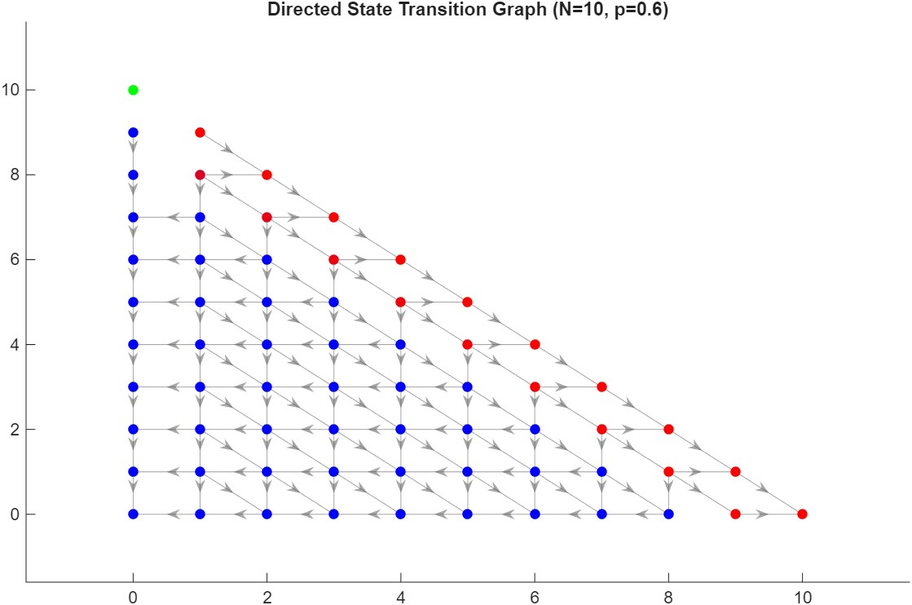
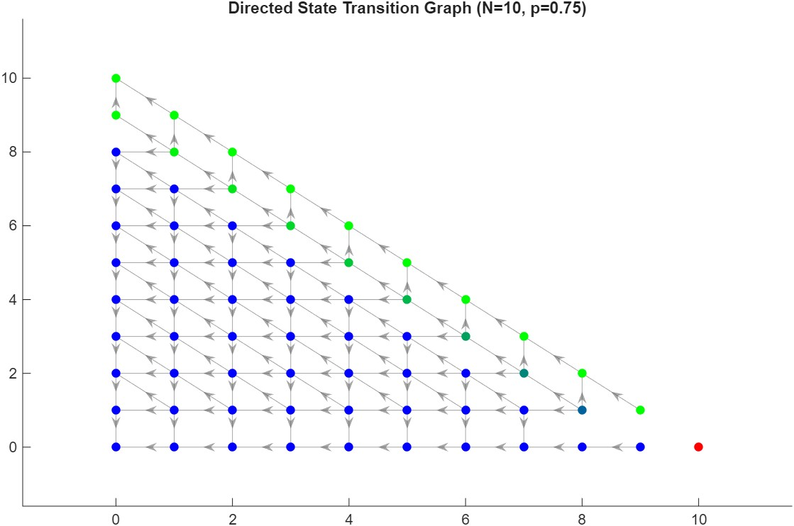

# Evolutionary Iterated Centipede Game

This project on Game Theory revolves around games derived from the classic Centipede game, an extensive form game of
perfect information played by two players, and explored various experimental approached and variants of it. This work is an extension to:

---

_I. Lazaridis, Ath. Kechagias, "Iterated Symmetric Centipede: Learning and Evolutionary Games"_

#### Contents

1. Introduction
2. Preliminaries
3. Iterated Centipede Game (ISC)
4. Nash Equilibria (NE)
5. Replicator Dynamics
6. Evolutionarily Stable Strategies (ESS)
7. Markovian Analysis

A snapshot of this work (1-3) is presented in `Laz-Kech-EvoCenti.pdf`

---

Our work, which is reported in `Evolutionary_ISC.pdf` extends the above by including:

1. An additional 3-strategy analysis with a different strategy set
2. A 5-strategy analysis of the game (3 from the original work + 2 of our own)
3. A two-population version of the game, along with its replicator dynamics

The code for this work was developed in MATLAB and is featured in the `code` folder, while the figures from the simulation results are in the `figs` folder. These are also presented in our report, where an appendix with more information on the scripts and functions can also be found.

----

<table>
  <tr>
    <td></td>
    <td></td>
  </tr>
</table>
